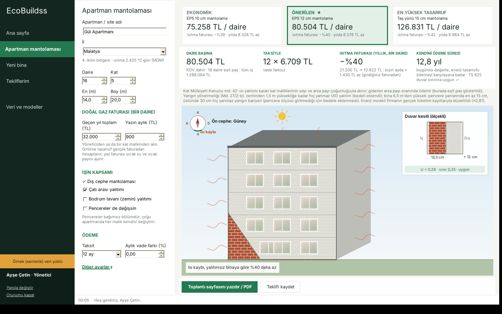
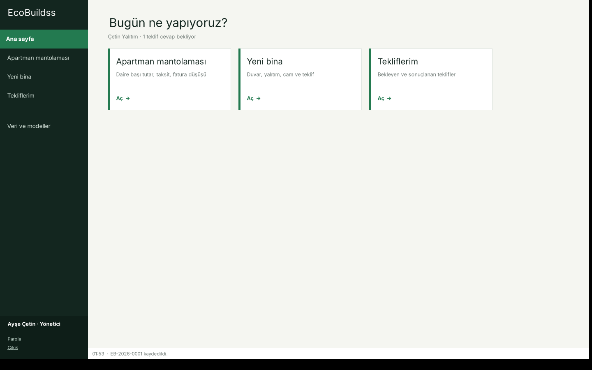
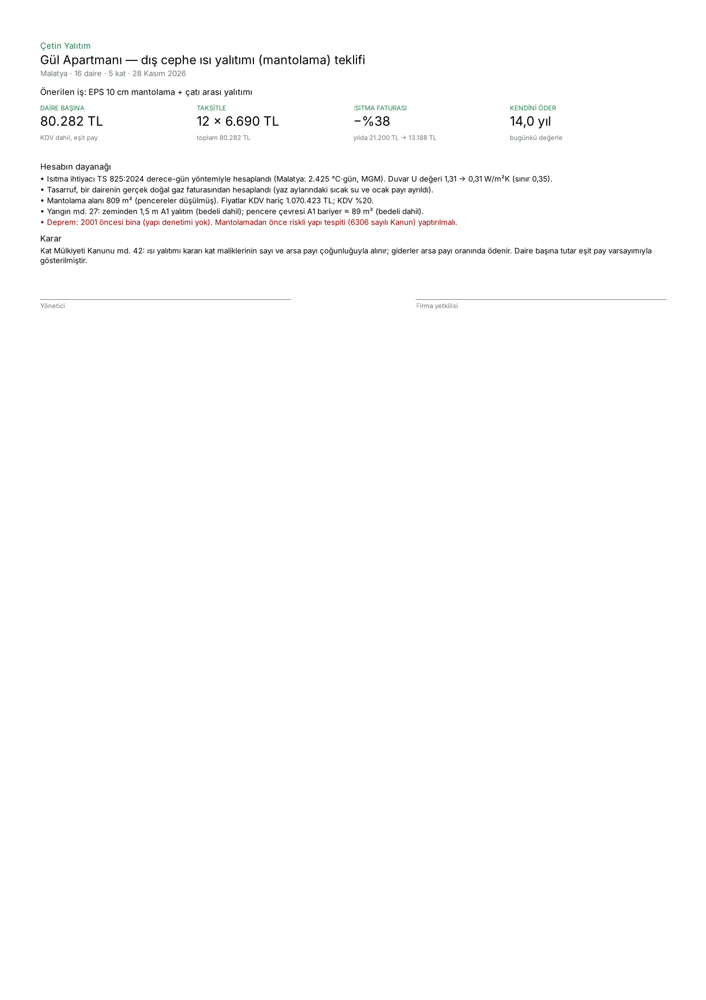
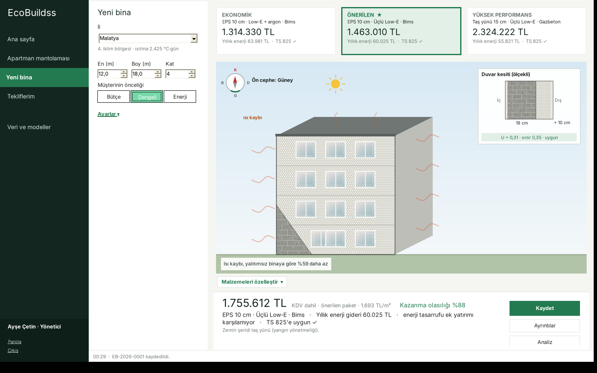
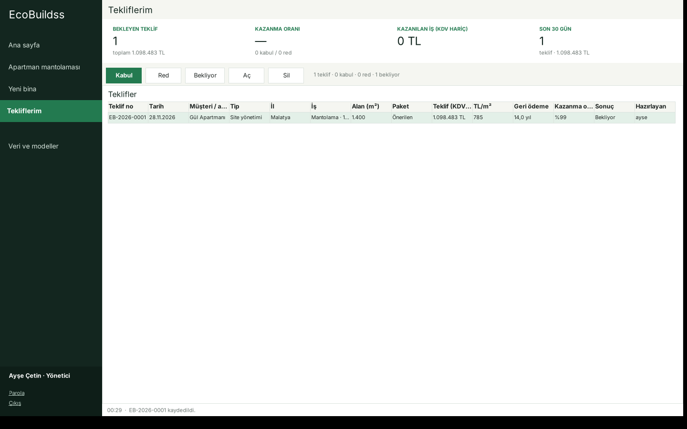
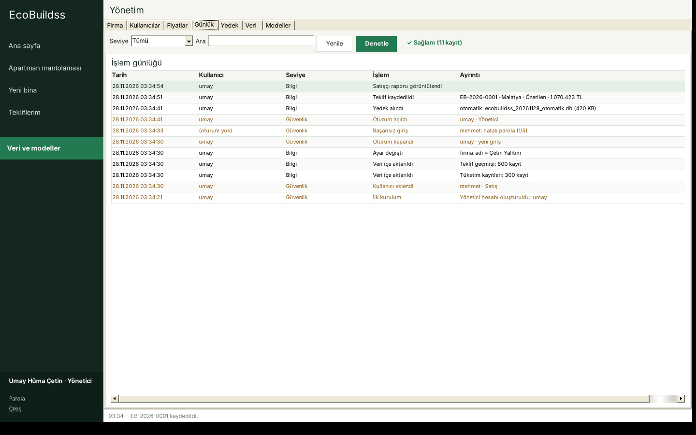
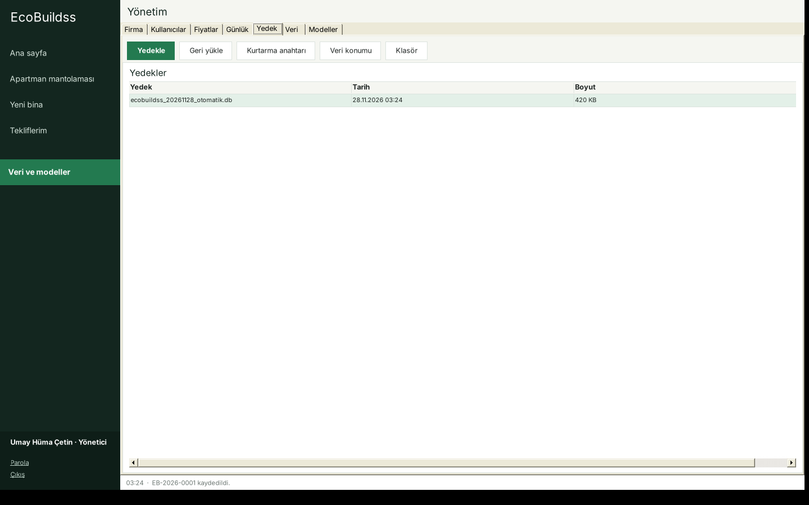
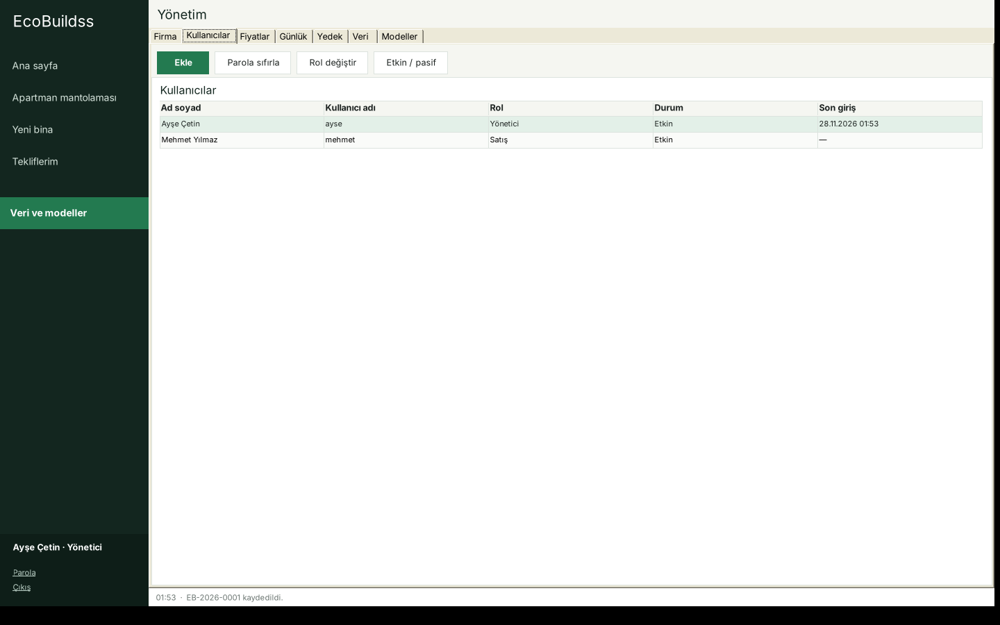
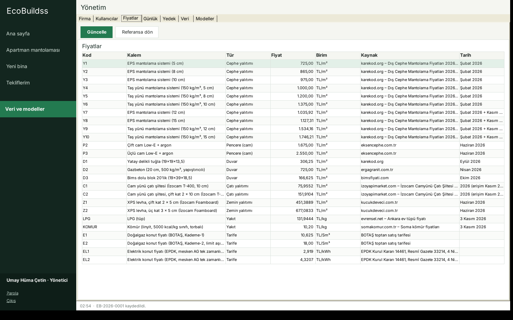

# EcoBuildss

Yalıtım ve inşaat firmaları için karar destek sistemi. Üç gerçek işi çözer:

1. **Apartman mantolaması.** Bu işler kat malikleri toplantısında kazanılır ya da kaybedilir. Toplantıda herkes aynı üç şeyi sorar: daire başına ne ödeyeceğim, faturam ne kadar düşecek, kaç yılda döner. Sahada 10 dakikada bu üç sorunun cevabı ve toplantıda dağıtılacak tek sayfa çıkar. Bir dairenin gerçek doğal gaz faturası girilirse tasarruf o faturadan hesaplanır.
2. **Yeni bina.** Ruhsattan önce TS 825 ve yangın yönetmeliğine uyan duvar–yalıtım–cam paketlerinden en uygun maliyetlisi; keşif, teklif ve Excel çıktısıyla.
3. **Tekliflerim.** Verilen tekliflerin takibi: bekleyen işler, kazanma oranı, kazanılan iş. Sonuçlar işaretlendikçe sistem firmanın kendi verisinden kazanma olasılığını öğrenir.

Geliştiren: **Umay Hüma Çetin**



## Ekranlar

| Ekran | Kullanıcıya sağladığı | Arkadaki yöntem |
|---|---|---|
| **Ana sayfa** | Üç işten birini seçme, bekleyen teklif sayısı | — |
| **Apartman mantolaması** | Daire başına tutar (KDV dahil), taksit, ısıtma faturasındaki düşüş, geri ödeme süresi, toplantı sayfası (yazdır / PDF) | TS 825 derece-gün modeli, gerçek faturadan tasarruf, iskontolu geri ödeme, anüite, Kat Mülkiyeti Kanunu md. 42 |
| **Yeni bina** | Üç paket, bina çizimi ve ölçekli duvar kesiti, malzemeleri tek tek değiştirme, keşif ve teklif, ayrıntılı analiz | AHP + TOPSIS, ömür boyu maliyet, kural tabanı (TS 825, yangın yönetmeliği md. 27), optimizasyon, Monte Carlo |
| **Tekliflerim** | Bekleyen / kazanılan işler, kazanma oranı, her teklifin kazanma olasılığı | Sınıflandırma (kalite eşiğini geçerse) |
| **Veri ve modeller** | Firma bilgileri, gerçek veri yükleme, modellerin doğrulaması | Regresyon (kalibrasyon), sınıflandırma, kümeleme |

| | |
|---|---|
|  |  |
|  |  |

## Güvenlik ve işlem günlüğü

**Kullanıcılar ve roller**
- Program oturum açılmadan açılmaz. İlk çalıştırmada firmanın yönetici hesabı oluşturulur; diğer kullanıcıları yönetici ekler.
- **Yönetici** her şeyi yapar. **Satış** teklif hazırlar, kaydeder ve sonucunu işaretler. Satış rolü teklif silemez, veri yükleyemez, kullanıcı ve ayar değiştiremez.
- Yetki yalnız arayüzde değil, veritabanı katmanında da denetlenir. Yetkisiz istek reddedilir ve günlüğe yazılır.
- Sistemde en az bir etkin yönetici kalması zorunludur.

**Şifreleme**
- Teklifin numara, tarih ve sonuç dışındaki her alanı (müşteri, il, bina ölçüleri, paket, tutar, indirim, kabul olasılığı, hazırlayan), içe aktarılan veri satırları ve günlük ayrıntıları veritabanında şifreli tutulur: AES-256-CBC + HMAC-SHA256 (önce şifrele, sonra doğrula), her değer için rastgele IV.
- Veri anahtarı rastgele üretilir ve hiçbir zaman düz saklanmaz. Her kullanıcının parolasından PBKDF2 ile türetilen anahtarla ayrı ayrı sarılır. Veritabanı dosyası kopyalansa bile parola olmadan bu alanlar okunamaz.
- İlk kurulumda 25 karakterlik bir **kurtarma anahtarı** bir kez gösterilir. Yönetici parolasını unutursa giriş ekranındaki **Parolamı unuttum** ile bu anahtarla yeni parola belirler. Anahtar kaybolursa ya da başkasının eline geçerse yönetici **Yedek → Kurtarma anahtarı** ile kendi parolasını girip yenisini üretir; eskisi geçersiz olur. Anahtar kaybolmuş ve hiçbir yönetici parolasını hatırlamıyorsa şifreli veri açılamaz; bu, şifrelemenin gereğidir.
- Oturum kapanınca anahtar bellekten silinir.

**Referans veri bütünlüğü**
- `veri/referans` dosyalarının SHA-256 özetleri `BUTUNLUK.sha256` dosyasındadır. Program her açılışta denetler; değiştirilmiş dosya varsa uyarır ve günlüğe Güvenlik kaydı düşer.

**Parolalar ve oturum**
- Parolalar PBKDF2-HMAC-SHA256 ile saklanır: 600.000 tekrar, kullanıcıya özel tuz. Parolanın kendisi hiçbir yerde tutulmaz.
- Parola kuralı: en az 8 karakter, harf ve rakam içermeli, kullanıcı adını içermemeli.
- Yöneticinin verdiği geçici parola ilk girişte değiştirilmek zorundadır.
- 5 hatalı denemede hesap 15 dakika kilitlenir. Kullanıcı adının var olup olmadığı giriş ekranında belli edilmez.
- 15 dakika işlem yapılmazsa oturum kilitlenir.

**İşlem günlüğü** (`islem_gunlugu` tablosu)
- Şu işlemler kim yaptıysa onun adıyla, tarih ve seviyesiyle (Bilgi, Uyarı, Hata, Güvenlik) yazılır:
  - program açılışı ve kapanışı
  - oturum açma ve kapama, başarısız giriş, hesap kilitlenmesi
  - teklif kaydı, silme, sonuç işaretleme, Excel'e aktarma, yazdırma
  - veri yükleme ve silme
  - ayar, kullanıcı ve parola değişiklikleri
  - yedek alma ve geri yükleme
  - hatalar
- Her kayıt bir öncekinin SHA-256 özetini içerir. Kayıtlar böylece zincirlenir: biri sonradan değiştirilir ya da silinirse denetim bunu bulur.
- Günlük **Veri ve modeller → Günlük** sekmesinden okunur: seviyeye göre süzülür, metinle aranır, **Denetle** zinciri baştan doğrular.
- Veritabanına yazılamayan hatalar ayrıca `%AppData%\EcoBuildss\hata.log` dosyasına yazılır.

**Fiyat güncelleme**
- Yönetici **Fiyatlar** sekmesinden malzeme, yakıt ve doğal gaz/elektrik tarifelerini günceller. Kaynak yazmak zorunludur; eski ve yeni değer günlüğe yazılır.
- Referans dosyalar değişmez (bütünlük denetimi bozulmaz). Güncel fiyat veritabanında tutulur, **Referansa dön** ile geri alınır.

**Yedek**
- Program her gün ilk açılışta otomatik yedek alır ve son 14 günün yedeğini saklar.
- Yönetici **Fiyat güncelleme**
- Yönetici **Fiyatlar** sekmesinden malzeme, yakıt ve doğal gaz/elektrik tarifelerini günceller. Kaynak yazmak zorunludur; eski ve yeni değer günlüğe yazılır.
- Referans dosyalar değişmez (bütünlük denetimi bozulmaz). Güncel fiyat veritabanında tutulur, **Referansa dön** ile geri alınır.

**Yedek** sekmesinden istediği an yedek alabilir ve yedekten geri yükleyebilir. Geri yüklemeden önce mevcut durum ayrıca yedeklenir; geri yüklemeden sonra yeniden giriş istenir.
- Yedekler SQLite'ın çevrimiçi yedekleme arayüzüyle alınır, yani tutarlıdır.

**Sınır:** Teklif numarası, tarih ve sonuç (Bekliyor/Kabul/Red) düz tutulur; numaralama ve sıralama bunlarla yapılır. Kullanıcı adları, roller ve güncellenen fiyatlar da düzdür. Yedekler şifreli alanlarıyla alınır.

| | |
|---|---|
|  |  |
|  |  |

## Kurulum

Gerekenler: Windows 10/11 ve Visual Studio 2022 (.NET 8, “.NET masaüstü geliştirme” iş yükü).

1. `EcoBuildss.sln` dosyasını açın.
2. **F5** tuşuna basın. Başlangıç projesi `EcoBuildss.App`'tir.
3. İlk açılışta yönetici hesabınızı oluşturun.

Hiçbir NuGet paketi gerekmez. SQLite'a Windows'un kendi `winsqlite3.dll` dosyasıyla bağlanılır. `nuget.config` paket kaynaklarını kapatır, bu yüzden proje internetsiz de derlenir. Veritabanı `%AppData%\EcoBuildss\ecobuildss.db` dosyasıdır.

## Gerçek veriyle kullanım

İlk açılışta veri yoktur. Teklif ekranı yine çalışır; enerji TS 825 modeliyle hesaplanır, kabul tahmini kapalıdır.

1. **Veri ve modeller → Veri → Şablon.** Tüketim kayıtları (faturalar) ve teklif geçmişi (CRM) için şablonu alın. Sütunlar [docs/VERI_SOZLUGU.md](docs/VERI_SOZLUGU.md) dosyasında açıklanmıştır.
2. Şablonu Excel'de doldurup CSV olarak kaydedin. Türkçe Excel'in `;` ayırıcısı ve `1.234,5` sayı biçimi de okunur.
3. **İçe aktar.** Denetim raporu her hatalı satırın satır numarasını, sütununu ve nedenini gösterir; hatalı satır alınmaz.
4. **Modeller** sekmesinde sonuçlara bakın. Bir model ancak kalite eşiğini geçerse teklif ekranında kullanılır:
   - **Kalibrasyon:** en az 20 kayıt gerekir. Görülmemiş kayıtlarda (5 katlı çapraz doğrulama) hatayı düşürmüyorsa uygulanmaz.
   - **Kabul tahmini:** en az 100 teklif ve her sonuçtan en az 20 kayıt gerekir. Modelin seçimde hiç kullanılmamış %25'lik test kümesinde şu üç koşulu sağlaması gerekir:
     - F1 ≥ 0,87
     - ROC-AUC ≥ 0,80
     - "her teklife kabul de" tahmininden belirgin iyi olmak

     Sağlamazsa teklif ekranında **gösterilmez**.
5. Uygulamada verilen her teklifi kaydedin, sonucu belli olunca **Tekliflerim** ekranında Kabul/Red işaretleyin. Model bu kayıtlarla kendini yeniden kurar.

## Modeller ve doğrulama

Programda örnek ya da sentetik veri yoktur; modeller yalnız firmanın kendi verisiyle kurulur. Modellerin kendisini sınamak için testler `tests/EcoBuildss.Tests/SentetikUretici.cs` ile **sentetik** veri üretir; aşağıdaki sonuçlar bu veriyle alınmıştır. Bu verideki binalar gerçek il iklimi ve gerçek malzeme fiyatlarıyla hesaplanmıştır. Kullanıcı ve müşteri davranışı ise `SentetikUretici.cs` içinde açıkça yazılı varsayımlarla üretilmiştir: kullanıcılar modelin %85'i kadar ısıtır, binadan binaya %18 sapma vardır, müşteri kararına gürültü eklenmiştir.

Sentetik veride F1 bu varsayımlara bağlıdır. Gerçek veride başarı, verinin kendisine bağlıdır ve önceden bilinemez. Bu yüzden kalite eşiği uygulamanın içindedir.

| Model | Ne çözer | Doğrulama | Sonuç (test verisi) |
|---|---|---|---|
| Kalibrasyon regresyonu | TS 825 modeli gerçek faturadan ne kadar sapıyor? Sıcak su baz yükü ne kadar? | 5 katlı çapraz doğrulama, ASHRAE Guideline 14 | β₁ = 0,814 (%95 GA 0,783–0,844); CV(RMSE) %23,6 → %18,8; NMBE %0,08 |
| Teklif kabul tahmini | Bu teklif kabul edilir mi? Hangi koşul kabulü artırır? | Tabakalı 5 katlı çapraz doğrulama + ayrı test kümesi | Lojistik regresyon. Çapraz doğrulama F1 0,905 ± 0,026. Test: F1 0,913, AUC 0,954 ("hep kabul" tahmininin F1'i 0,750) |
| İl kümeleme | Pazar hangi iklim bölgelerine ayrılıyor? Bölgeye standart paket ne olmalı? | Davies–Bouldin, siluet | k = 2 (DB 0,594, siluet 0,570). Gerçek MGM verisi |
| Müşteri segmentleri | Hangi müşteri grubu hangi koşulda kabul ediyor? | Davies–Bouldin, siluet | k = 6 (siluet 0,30) |

Modellerin doğru çalıştığı da ayrıca sınanmıştır:
- **Etiketler rastgele karıştırıldığında** (veride sinyal yokken) kabul modeli kalite eşiğinden **geçemez** (AUC ≈ 0,5). Eşiğin sahte başarıyı yakaladığını gösterir.
- **Python ile bağımsız tekrar:** testlerin ürettiği dosyalar `dotnet run --project tests/EcoBuildss.Tests -- --ornek-yaz <klasör>` ile yazılır; `araclar/dogrulama/bagimsiz_dogrulama.py <klasör>` aynı dosyalardan scikit-learn ile yeniden hesaplar. Regresyon katsayıları ve il kümeleri birebir aynı çıkar. Kabul modeli farklı bir rastgele bölmede aynı düzeyde kalır (lojistik regresyon test F1 0,922).

## Testler

```
dotnet run --project tests/EcoBuildss.Tests
python araclar/dogrulama/bagimsiz_dogrulama.py <klasör>   # isteğe bağlı: pandas, scikit-learn
```

106 test vardır ve şunları kapsar:
- metrikler (F1, AUC, CV(RMSE))
- regresyon ve gerçek levha fiyatları
- enerji motoru ve yangın yönetmeliği kuralı
- hatalı CSV satırlarının reddi
- uçtan uca veri akışı (test içinde üretilen sentetik veriyle)
- pencere çevresi yangın bariyeri alanı, dikdörtgen olmayan plan
- referans veri bütünlüğü; 81 ilin hepsinde TS 825'e uyan paket bulunması
- az veride ve sinyalsiz veride kalite eşiğinin modeli reddetmesi
- apartman hesabı (kapsam, faturadan tasarruf, taksit)
- SQLite kaydı (parametreli sorgu)
- güvenlik: parola özeti, kilitleme, roller, geçici parola, alan şifreleme ve değiştirilmiş şifreli değerin yakalanması, kurtarma anahtarı ve yenilenmesi, teklif ayrıntılarının diskte şifreli olması, fiyat güncelleme ve geri alma, günlük zinciri ve değişiklik tespiti, yedek ve geri yükleme

## Klasörler

```
src/EcoBuildss.Core     Hesap çekirdeği (arayüzden bağımsız, test edilebilir)
  Referans/             Kaynak gösterimli referans verinin okunması
  Enerji/               TS 825 derece-gün enerji modeli, ömür boyu maliyet, AHP + TOPSIS, yangın kuralı
  Karar/                Optimizasyon, Pareto, duyarlılık, Monte Carlo, KPI
  Ogrenme/              Regresyon, lojistik regresyon, karar ağacı, rastgele orman, k-ortalamalar, metrikler (dış kütüphane yok)
  Veri/                 CSV şemaları ve içe aktarma denetimi
  Uygulamalar/          Kalibrasyon, kabul tahmini, segmentasyon
  Depo/                 SQLite (winsqlite3) ve veritabanı
src/EcoBuildss.App      Windows Forms arayüzü
tests/EcoBuildss.Tests  Birim ve bütünleşik testler
veri/referans           İklim (MGM), TS 825:2024, yangın yönetmeliği, malzeme fiyatları, tarifeler; her satırda kaynak
araclar/dogrulama       Python ile bağımsız doğrulama
docs/                   Veri sözlüğü, ekran görüntüleri
```

## Sınırlılıklar

- Enerji modeli yıllık derece-gün yöntemidir. MGM derece-günü 15 °C eşikle hesaplandığı için ortalama güneş ve iç kazançlar denge sıcaklığında zaten vardır; cepheye göre güneş kazancı ayrıca hesaplanmaz (ikinci kez sayılmasın diye). Bina bazındaki sapmayı kalibrasyon gerçek tüketimle düzeltir.
- Dikdörtgen olmayan planda (L, U, T) **Ayarlar**'dan plan çevresi ve taban alanı girilir; çizim yaklaşık gösterilir.
- Pencere yangın bariyeri, pencere ölçüsü girilmediği için tipik 120 × 150 cm pencereyle hesaplanır (`parametreler.csv` B6–B7).
- Kabul tahmininin F1 ≥ 0,87 sonucu test verisindedir. Gerçek veride model, eşiği geçmedikçe gösterilmez.
- Referans fiyatlar dosyalardaki tarihlidir; güncel fiyat **Fiyatlar** sekmesinden girilir.

## Lisans

[LICENSE](LICENSE)
