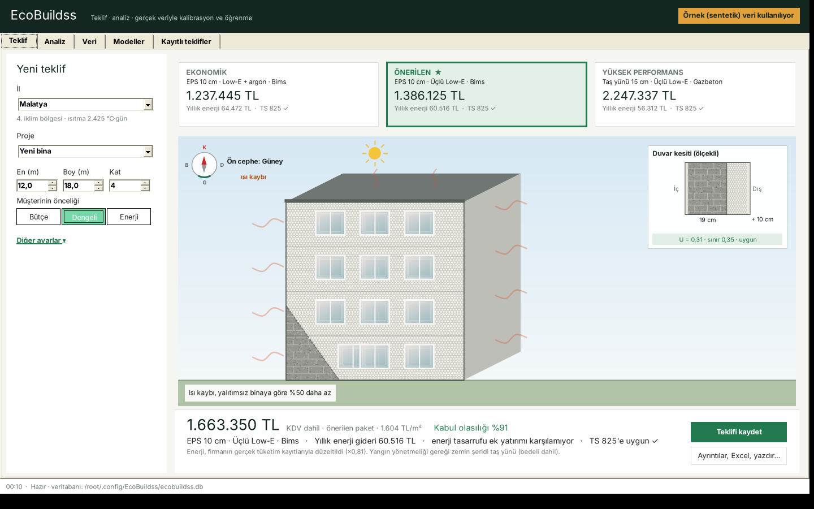

# EcoBuildss

Yeşil bina malzeme seçimi için karar destek sistemi. Bir yalıtım/inşaat firmasının teklif mühendisi; ili, binanın ölçülerini ve müşterinin önceliğini girer. Sistem 60 malzeme paketini (10 mantolama × 2 pencere camı × 3 duvar) hesaplar, TS 825 ve yangın yönetmeliğine uymayanları eler ve üç paket önerir. Firma kendi faturalarını ve teklif geçmişini yükledikçe enerji tahminini gerçek tüketime göre düzeltir ve teklifin kabul edilme olasılığını öğrenir.

Geliştiren: **Umay Hüma Çetin**



## Ne yapar?

| Ekran | Kullanıcıya sağladığı | Yöntem |
|---|---|---|
| **Teklif** | İl ve bina girilir; ekonomik, önerilen ve yüksek performans paketleri, keşif, teklif tutarı, geri ödeme ve kabul olasılığı. Excel ve yazdır/PDF. | TS 825 derece-gün enerji modeli, ömür boyu maliyet, AHP + TOPSIS, kural tabanı |
| **Analiz** | Ekonomik yalıtım kalınlığı, bütçeye sığan en iyi paket, fiyatlar değişirse önerinin değişip değişmediği, fiyat riskine göre maliyet aralığı | Altın oran araması, fiyat regresyonu, Pareto, duyarlılık, Monte Carlo |
| **Veri** | Firmanın kendi CSV dosyalarını içeri alır. Her satır denetlenir; hatalı satır alınmaz ve nedeni yazılır. | Şema denetimi |
| **Modeller** | Enerji modelinin gerçek tüketimle kalibrasyonu, teklif kabul tahmini, il ve müşteri segmentleri | Çoklu doğrusal regresyon, lojistik regresyon / karar ağacı / rastgele orman, k-ortalamalar++ |
| **Kayıtlı teklifler** | Teklifler SQLite'ta saklanır. Sonuç (Kabul/Red) işaretlendikçe model firmanın kendi sonuçlarından öğrenir. | Veritabanı, sürekli öğrenme |

## Kurulum

Gerekenler: Windows 10/11 ve Visual Studio 2022 (.NET 8, “.NET masaüstü geliştirme” iş yükü).

1. `EcoBuildss.sln` dosyasını açın.
2. **F5** tuşuna basın. Başlangıç projesi `EcoBuildss.App`'tir.

Hiçbir NuGet paketi gerekmez. SQLite'a Windows'un kendi `winsqlite3.dll` dosyasıyla bağlanılır. `nuget.config` paket kaynaklarını kapatır, bu yüzden proje internetsiz de derlenir. Veritabanı `%AppData%\EcoBuildss\ecobuildss.db` dosyasıdır.

## Gerçek veriyle kullanım

İlk açılışta veri yoktur. Teklif ekranı yine çalışır; enerji TS 825 modeliyle hesaplanır, kabul tahmini kapalıdır.

1. **Veri → Boş şablon kaydet.** Tüketim kayıtları (faturalar) ve teklif geçmişi (CRM) için şablonu alın. Sütunlar [docs/VERI_SOZLUGU.md](docs/VERI_SOZLUGU.md) dosyasında açıklanmıştır.
2. Şablonu Excel'de doldurup CSV olarak kaydedin. Türkçe Excel'in `;` ayırıcısı ve `1.234,5` sayı biçimi de okunur.
3. **Veri → Kendi dosyamı içe aktar.** Denetim raporu her hatalı satırın satır numarasını, sütununu ve nedenini gösterir. Gerçek veri yüklenince örnek veri silinir, ikisi karışmaz.
4. **Modeller** sekmesinde sonuçlara bakın. Bir model ancak kalite eşiğini geçerse teklif ekranında kullanılır:
   - **Kalibrasyon:** en az 20 kayıt gerekir. Görülmemiş kayıtlarda (5 katlı çapraz doğrulama) hatayı düşürmüyorsa uygulanmaz.
   - **Kabul tahmini:** en az 100 teklif ve her sonuçtan en az 20 kayıt gerekir. Modelin seçimde hiç kullanılmamış %25'lik test kümesinde şu üç koşulu sağlaması gerekir:
     - F1 ≥ 0,87
     - ROC-AUC ≥ 0,80
     - "her teklife kabul de" tahmininden belirgin iyi olmak

     Sağlamazsa teklif ekranında **gösterilmez**.
5. Uygulamada verilen her teklifi kaydedin, sonucu belli olunca **Kayıtlı teklifler** sekmesinde Kabul/Red işaretleyin. Model bu kayıtlarla kendini yeniden kurar.

Gerçek veri yokken denemek için **Veri → Örnek (sentetik) veriyi yükle** düğmesi vardır. Örnek veri kullanıldığı sürece üst bantta uyarı görünür.

## Modeller ve doğrulama

Aşağıdaki sonuçlar `veri/ornek` klasöründeki **sentetik** veriyle alınmıştır. Bu verideki binalar gerçek il iklimi ve gerçek malzeme fiyatlarıyla hesaplanmıştır. Kullanıcı ve müşteri davranışı ise `SentetikUretici.cs` içinde açıkça yazılı varsayımlarla üretilmiştir: kullanıcılar modelin %85'i kadar ısıtır, binadan binaya %18 sapma vardır, müşteri kararına gürültü eklenmiştir.

Sentetik veride F1 bu varsayımlara bağlıdır. Gerçek veride başarı, verinin kendisine bağlıdır ve önceden bilinemez. Bu yüzden kalite eşiği uygulamanın içindedir.

| Model | Ne çözer | Doğrulama | Sonuç (örnek veri) |
|---|---|---|---|
| Kalibrasyon regresyonu | TS 825 modeli gerçek faturadan ne kadar sapıyor? Sıcak su baz yükü ne kadar? | 5 katlı çapraz doğrulama, ASHRAE Guideline 14 | β₁ = 0,814 (%95 GA 0,783–0,844); CV(RMSE) %23,6 → %18,8; NMBE %0,08 |
| Teklif kabul tahmini | Bu teklif kabul edilir mi? Hangi koşul kabulü artırır? | Tabakalı 5 katlı çapraz doğrulama + ayrı test kümesi | Lojistik regresyon. Çapraz doğrulama F1 0,896 ± 0,014. Test: F1 0,915, AUC 0,964 ("hep kabul" tahmininin F1'i 0,718) |
| İl kümeleme | Pazar hangi iklim bölgelerine ayrılıyor? Bölgeye standart paket ne olmalı? | Davies–Bouldin, siluet | k = 2 (DB 0,594, siluet 0,570). Gerçek MGM verisi |
| Müşteri segmentleri | Hangi müşteri grubu hangi koşulda kabul ediyor? | Davies–Bouldin, siluet | k = 4 (siluet 0,32) |

Modellerin doğru çalıştığı da ayrıca sınanmıştır:
- **Etiketler rastgele karıştırıldığında** (veride sinyal yokken) kabul modeli kalite eşiğinden **geçemez** (AUC ≈ 0,5). Eşiğin sahte başarıyı yakaladığını gösterir.
- **Python ile bağımsız tekrar:** `araclar/dogrulama/bagimsiz_dogrulama.py` aynı dosyalardan scikit-learn ile yeniden hesaplar. Regresyon katsayıları ve il kümeleri birebir aynı çıkar. Kabul modeli farklı bir rastgele bölmede aynı düzeyde kalır (lojistik regresyon test F1 0,906).

## Testler

```
dotnet run --project tests/EcoBuildss.Tests
python araclar/dogrulama/bagimsiz_dogrulama.py          # isteğe bağlı: pandas, scikit-learn
python araclar/dogrulama/bagimsiz_dogrulama.py <klasör> # kendi gerçek veriniz için
```

46 test vardır ve şunları kapsar:
- metrikler (F1, AUC, CV(RMSE))
- regresyon ve gerçek levha fiyatları
- enerji motoru ve yangın yönetmeliği kuralı
- hatalı CSV satırlarının reddi
- uçtan uca örnek veri akışı
- az veride ve sinyalsiz veride kalite eşiğinin modeli reddetmesi
- SQLite kaydı (parametreli sorgu)

## Klasörler

```
src/EcoBuildss.Core     Hesap çekirdeği (arayüzden bağımsız, test edilebilir)
  Referans/             Kaynak gösterimli referans verinin okunması
  Enerji/               TS 825 derece-gün enerji modeli, ömür boyu maliyet, AHP + TOPSIS, yangın kuralı
  Karar/                Optimizasyon, Pareto, duyarlılık, Monte Carlo, KPI
  Ogrenme/              Regresyon, lojistik regresyon, karar ağacı, rastgele orman, k-ortalamalar, metrikler (dış kütüphane yok)
  Veri/                 CSV şemaları ve içe aktarma denetimi
  Uygulamalar/          Kalibrasyon, kabul tahmini, segmentasyon
  Sentetik/             Örnek veri üreteci (yalnız deneme için)
  Depo/                 SQLite (winsqlite3) ve veritabanı
src/EcoBuildss.App      Windows Forms arayüzü
tests/EcoBuildss.Tests  Birim ve bütünleşik testler
veri/referans           İklim (MGM), TS 825:2024, yangın yönetmeliği, malzeme fiyatları, tarifeler; her satırda kaynak
veri/ornek              Sentetik örnek veri (gerçek değildir)
araclar/dogrulama       Python ile bağımsız doğrulama
docs/                   Veri sözlüğü, ekran görüntüleri
```

## Sınırlılıklar

- Enerji modeli yıllık derece-gün yöntemidir. Güneş kazancı ve ısıl kütle ayrı hesaplanmaz. Kalibrasyon bu sapmayı gerçek tüketimle toplu olarak düzeltir.
- Bina dikdörtgen plan olarak girilir. Dikdörtgen olmayan planlar için çekirdekte `Bina.Alanlarla(...)` vardır.
- Referans fiyatlar Kasım 2026 tarihlidir. Malzeme ve tarife güncellemesi `veri/referans` dosyalarından yapılır; her satırda kaynak ve tarih bulunur.

## Lisans

[LICENSE](LICENSE)
