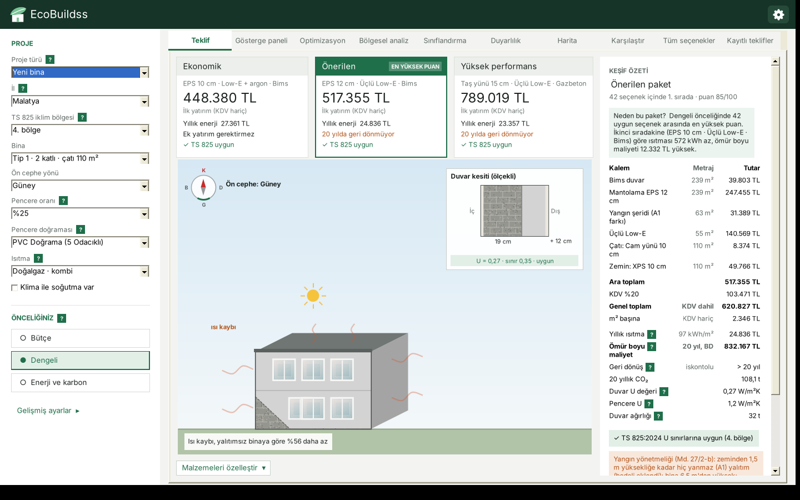
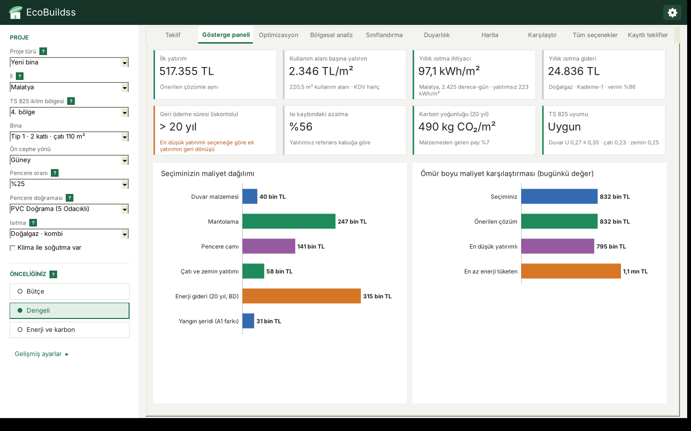
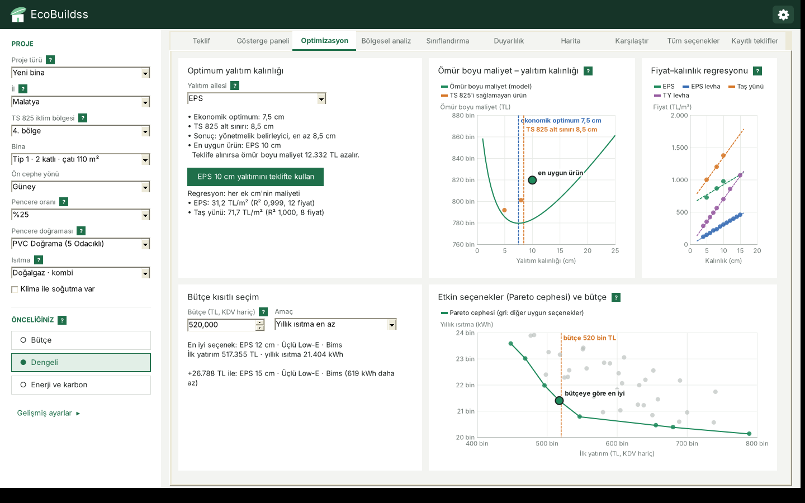
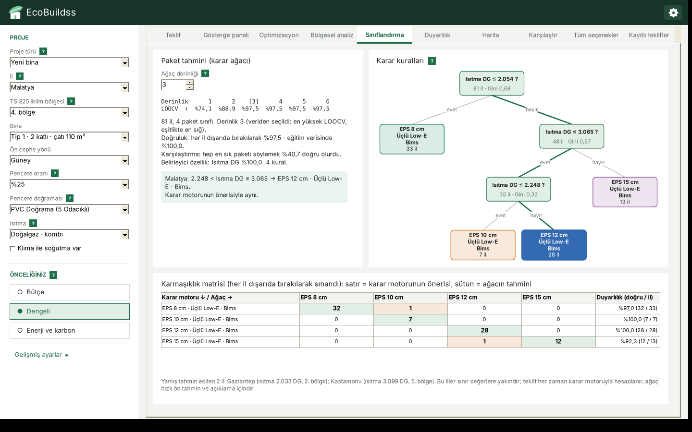
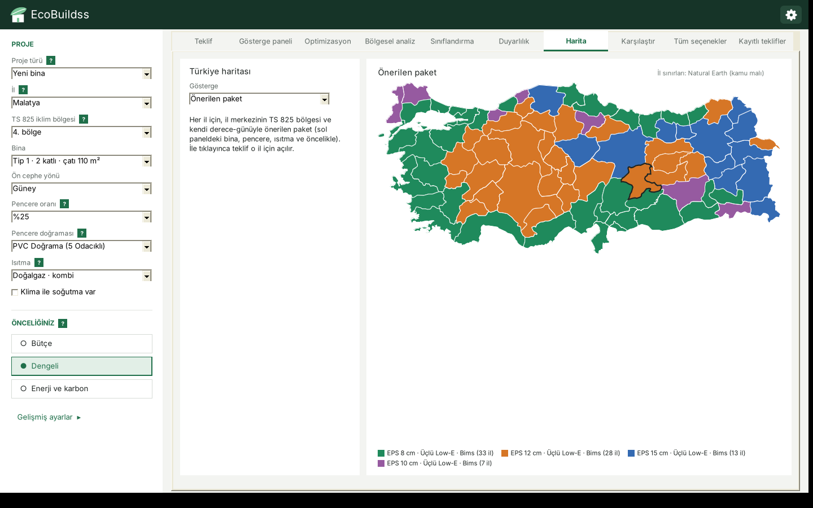

# EcoBuildss – Yeşil Bina Malzeme Seçimi Karar Destek Sistemi

**Geliştiren:** Umay Hüma Çetin · Fırat Üniversitesi, Yönetim Bilişim Sistemleri · *İşletmeler için Karar Destek Sistemleri* dersi projesi (2026)



Yeşil bina için mantolama (dış cephe yalıtımı), pencere camı ve duvar malzemesi seçimine yönelik karar destek sistemi.
81 ilin MGM iklim verisi ve TS 825:2024 iklim bölgesi sınırlarıyla çalışır (varsayılan: Malatya, 4. bölge).
Analitik yöntemler: **optimizasyon**, **regresyon**, **sınıflandırma** ve **kümeleme**. C# / WinForms / .NET 8 / SQLite.

## Klasörler

| Klasör / dosya | İçerik |
|---|---|
| `EcoBuildss.sln`, `EcoBuildss.csproj`, `Program.cs` | Visual Studio çözümü ve uygulama projesi |
| `Core/` | Hesap çekirdeği (enerji ve maliyet modeli, AHP/TOPSIS, optimizasyon, regresyon, sınıflandırma, kümeleme, Monte Carlo) |
| `Depo/` | SQLite veritabanı ve işlem günlüğü |
| `UI/` | WinForms arayüzü |
| `Veri/` | Kaynaklı CSV veri dosyaları (uygulama ilk açılışta bunlardan veritabanını kurar) |
| `EcoBuildss.Testler/` | 77 birim testi |
| `dogrulama/` | Modeli C#'tan bağımsız yeniden hesaplayan Python betikleri ve uygulamanın sonuç dökümleri (`cs_*.csv`) |
| `docs/` | Ekran görüntüleri, veri hazırlık süreci belgesi |
| `TEST_RAPORU.md` | Test ve doğrulama raporu |

## Ekran görüntüleri

| | |
|---|---|
|  |  |
|  |  |

## Çalıştırma

**Gerekli:** Windows, .NET 8 SDK ve internet bağlantısı (ilk derlemede SQLite sürücüsü NuGet'ten iner).

### Visual Studio
1. `EcoBuildss.sln` dosyasına çift tıkla.
2. Üstteki yeşil **▶ EcoBuildss** düğmesine bas (F5). İlk derlemede Visual Studio `Microsoft.Data.Sqlite`
   paketini kendisi indirir. İnmezse: Çözüm Gezgini'nde çözüme sağ tıkla → *NuGet Paketlerini Geri Yükle*.
3. Testler: Çözüm Gezgini'nde **EcoBuildss.Testler**'e sağ tıkla → *Başlangıç Projesi Olarak Ayarla* → F5.

### Komut satırı
```
dotnet run --project EcoBuildss.csproj
```

### Tek dosyalık .exe (sunum için)
```
dotnet publish -c Release -r win-x64 --self-contained true -p:PublishSingleFile=true -p:IncludeNativeLibrariesForSelfExtract=true
```
`bin\Release\net8.0-windows\win-x64\publish\` klasöründeki `EcoBuildss.exe` ile birlikte `Veri` klasörünü kopyala.

## Veritabanı

Uygulama veriyi **SQLite** veritabanından okur: `Veri\ecobuildss.db` (Veri klasörüne yazılamıyorsa
`%LOCALAPPDATA%\EcoBuildss\ecobuildss.db`). İlk açılışta veritabanı CSV dosyalarından oluşturulur; CSV dosyaları
değiştirilirse bir sonraki açılışta referans tablolar yeniden yüklenir, **kayıtlı teklifler korunur**.

| Tablo | İçerik |
|---|---|
| `bina_tipleri` | 12 bina geometrisi (Tsanas ve Xifara 2012, ENB2012'nin 768 kaydından çıkarıldı; hacim makaledeki 771,75 m³) |
| `malzemeler` | 15 karar seçeneği (10 mantolama: EPS ve taş yünü 5/8/10/12/15 cm; 2 kaplamalı cam; 3 duvar): fiyat, ısıl değer, karbon, fiyat hesabı ve kaynakları. 12 ve 15 cm'nin fiyatı yayımlanmış iki değerden hesaplanmıştır (aşağıya bakın) |
| `cati_zemin` | Çatı (cam yünü şilte 10 cm ya da çift kat 2 × 10 cm) ve zemin (XPS 2 × 5 cm) katmanı: ısıl değer, fiyat ve kaynakları. Çatı katmanı bölgeye göre seçilir: sınırı sağlayanların en ucuzu |
| `parametreler` | 27 ham parametre: doğalgaz ve elektrik tarifesi, ısıl değer, emisyon, klima verimi (SEER, SCOP), yangın yönetmeliği eşikleri, referans kabuk, hesap katsayıları, ekonomi ve kaynakları |
| `iller` | 81 il: yıllık ısıtma ve soğutma derece-günü (MGM; 78 il Şensoy vd. 1975–2005, Çankırı, Karabük, Şırnak MGM gün-derece sayfası 1991–2005 ortalaması) |
| `il_bolgeleri` | 81 il merkezinin TS 825:2024 bölgesi ve kaynağı |
| `ts825_bolgeler` | TS 825:2024'ün 6 iklim bölgesinin duvar, çatı, zemin ve pencere U sınırları |
| `ts825_pencere` | TS 825:2024 Ek A.3 pencere U değerleri (cam + doğrama): 9 doğrama tipi × 2 kaplamalı cam tipi × 12/16 mm ara boşluk (İZODER il föyleri; 13 föyde birebir aynı) |
| `yakitlar` | Doğalgaz dışındaki ısıtma: LPG (tüp), kömür (linyit, 5000 kcal/kg sınıfı), dirençli elektrikli ısıtıcı, ısı pompalı klima; fiyat, ısıl değer, cihaz verimi, emisyon ve kaynakları |
| `yangin_siniflari` | EPS ve taş yünü mantolama sistemlerinin yangın tepki sınıfı (EPS levha E, sistem B-s1,d0; taş yünü A1) ve kaynakları |
| `levha_fiyatlari` | Mantolama levhası fiyat serileri, 4–15 cm: taş yünü (8 kalınlık, Kasım 2026; Ekim fiyatlarıyla aynı) ve EPS (12 kalınlık, Kasım 2026); her seri tek ürün ve tek satıcı |
| `teklifler` | Kaydedilen teklifler: proje adı, girdiler (proje türü, yakıt, soğutma, enerji artışı dahil), seçilen malzemeler, tutarlar |
| `islem_kayitlari` | Arka plan işlem günlüğü (kullanıcıya gösterilmez): tarih, tür (Bilgi / Uyarı / Hata), işlem, ayrıntı, Windows kullanıcısı ve bilgisayar adı. Yazılan işlemler: uygulamanın açılıp kapanması, CSV'den veri yüklemesi, teklif kaydetme / açma / silme, yazdırma, Excel'e aktarma ve bütün beklenmeyen hatalar (hata ayrıntısıyla). En fazla 20.000 kayıt tutulur, eskiler silinir |
| `veri_surumu` | CSV dosyalarının boyut ve tarih imzası (değişikliği algılamak için) |

`Veri/il_sinirlari.csv` yalnız harita içindir (Natural Earth 1:10m il sınırları, kamu malı, sadeleştirilmiş); veritabanına alınmaz.

`ecobuildss.db` dosyası DB Browser for SQLite (ücretsiz) ile açılıp incelenebilir. İşlem günlüğü için:
`SELECT tarih, tur, islem, ayrinti FROM islem_kayitlari ORDER BY id DESC;`
Veritabanı açılamazsa uygulama CSV dosyalarıyla çalışmaya devam eder ve alt çubukta bunu yazar.

## Proje yapısı

| Dosya | Görevi | KDS bileşeni |
|---|---|---|
| `Veri/*.csv` | Kaynaklı ham veri (bina, malzeme, parametre) | Veri |
| `Depo/Veritabani.cs`, `Depo/SqliteBaglanti.cs`, `Depo/Gunluk.cs` | SQLite: tablo oluşturma, CSV'den yükleme, okuma, teklif kaydetme, arka plan işlem günlüğü | Veri |
| `Core/Veri.cs` | CSV okuyucu, bina geometrisi (ENB formları ve özel ölçü), malzeme | Veri |
| `Core/KararMotoru.cs` | TS 825 derece-gün enerji hesabı, ömür boyu maliyet, AHP, TOPSIS, duyarlılık | Model |
| `Core/Optimizasyon.cs` | Fiyat–kalınlık regresyonu, optimum yalıtım kalınlığı, bütçe kısıtlı seçim, Pareto | Model |
| `Core/Kumeleme.cs` | İllerin iklime göre k-ortalamalar kümelemesi; küme sayısı Davies–Bouldin endeksiyle, siluet katsayısıyla kontrol | Model |
| `Core/TeklifRaporu.cs`, `Core/XlsxYazici.cs` | "Neden bu paket?" gerekçesi; teklifin Excel (.xlsx) dökümü (ek paket gerektirmez) | Model |
| `Core/Analitik.cs` | KPI hesapları (iskontolu geri ödeme, yenilemede mevcut duruma göre tasarruf ve net bugünkü değer) | Model |
| `Core/Belirsizlik.cs` | Fiyat belirsizliği (Monte Carlo): önerinin birinci kalma oranı | Model |
| `UI/AcilisEkrani.cs` | Açılış animasyonu (logo kurulur, ad belirir; çizgi dolunca ana pencere hazırlanır, tıklayınca atlanır) | Diyalog |
| `UI/AnaForm.cs` | Ana pencere, proje girişi, teklif ekranı, keşif özeti | Diyalog |
| `UI/AnaForm.Optimizasyon.cs` | Optimizasyon sekmesi (optimum kalınlık, regresyon, bütçe) | Diyalog |
| `UI/AnaForm.Bolgesel.cs` | Bölgesel analiz sekmesi (kümeleme ve kümelere göre karar) | Diyalog |
| `Core/Siniflandirma.cs` | Karar ağacı (CART, Gini), LOOCV ile derinlik seçimi, karmaşıklık matrisi | Model |
| `UI/AnaForm.Siniflandirma.cs`, `UI/AgacCizimi.cs` | Sınıflandırma sekmesi: ağaç çizimi, seçili ilin kuralı, karmaşıklık matrisi | Diyalog |
| `UI/AnaForm.Analiz.cs` | Gösterge paneli ve Duyarlılık sekmeleri (fiyat belirsizliği dahil) | Diyalog |
| `UI/AnaForm.Harita.cs`, `UI/Harita.cs` | Türkiye haritası: il bazında öneri, optimum kalınlık, enerji gideri, küme, bölge | Diyalog |
| `UI/AnaForm.Karsilastir.cs` | İki senaryoyu yan yana karşılaştırma | Diyalog |
| `UI/MalzemeYonetimi.cs` | Malzeme ekleme ve düzenleme (kaynak, tarih ve fiyat hesabı zorunlu) | Veri |
| `UI/AnaForm.Kayit.cs` | Kayıtlı teklifler: kaydet / aç / sil | Diyalog |
| `UI/AnaForm.Teklif.cs` | Teklif belgesinin yazdırılması (PDF için "Microsoft Print to PDF") | Diyalog |
| `UI/AnaForm.Yardim.cs` | İlk açılış rehberi, terim açıklamaları ("?" işaretleri), Excel'e aktarma | Diyalog |
| `UI/Grafik.cs`, `BinaPanel.cs`, `PaketKarti.cs`, `MalzemeKarti.cs`, `Doku.cs`, `Marka.cs` | Grafikler (kütüphanesiz GDI+), bina çizimi, kartlar | Diyalog |
| `EcoBuildss.Testler/` | 77 birim testi (`dotnet run`) | — |

## Yöntem

**Enerji (TS 825 derece-gün yöntemi, seçilen ilin MGM derece-günü):**
H = U_duvar·A_opak + U_pencere·A_pencere + 0,8·U_çatı·A_çatı + 0,5·U_zemin·A_zemin + 0,33·n_h·0,8·V ;
yıllık ısıtma (kWh) = 0,024 × derece-gün × H (Malatya 2425) ; yakıt = ısıtma ÷ 0,86 (kazan verimi).
U_pencere, seçilen doğrama ve cam için TS 825:2024 Ek A.3'teki pencere (cam + doğrama) U değeridir.
TS 825 kontrolü seçilen iklim bölgesinin dört U sınırıyla yapılır.

**Ömür boyu maliyet (bugünkü değer):** ilk yatırım + PWF × yıllık ısıtma gideri ;
PWF = [1 − (1 + r)^−N] ÷ r ; reel iskonto r = (0,36 − 0,2977) ÷ 1,2977 = %4,80 (TCMB faizi, TÜİK enflasyonu).

**Çok kriterli karar:** AHP (öncelik ağırlıkları, CR ≤ 0,10) + TOPSIS (ömür boyu maliyet, yıllık ısıtma, toplam CO₂).

Uygulamada üç analitik yöntem var; üçü de karara doğrudan girdi verir.

**Isıtma yakıtı:** doğalgaz (BOTAŞ, kombi %86), LPG (tüp, kombi %86), kömür (kapalı soba %65, AB 2015/1185), dirençli elektrikli ısıtıcı (%100)
ya da ısı pompalı klima (SCOP 3,8, AB 206/2012). Yakıt = ısıtma ÷ verim; gider = yakıt × TL/kWh (fiyat ÷ ısıl değer); emisyon IPCC 2006
ve ETKB şebeke faktörü. **Soğutma** (klima varsa): 0,024 × soğutma derece-günü (MGM, 22 °C) × H ÷ SEER 4,6 = elektrik; gider ve CO₂'ye
eklenir. Güneş kazancı hesaba katılmadığından soğutma gerçek yükün altında kalır; seçenekleri karşılaştırmak içindir.

**Mevcut bina (yenileme):** duvar yerinde kalır (referans U 1,78 W/m²K); yalıtımlı duvar U = 1 ÷ (1/1,78 + d/λ); duvar bedeli ve karbonu yoktur.
Seçenekler mantolama × cam (20). Sonuç, yalıtımsız mevcut binanın aynı yakıt ve soğutma koşulundaki yıllık giderine göre tasarruf,
iskontolu geri dönüş süresi ve analiz süresi sonundaki net bugünkü değerdir.

**Yangın yönetmeliği** (Binaların Yangından Korunması Hakkında Yönetmelik Md. 27): bina yüksekliği 28,50 m'den fazlaysa dış cephe
sistemi en az A2-s1,d0 olmalıdır; EPS sistemi B-s1,d0 olduğundan bu binalarda EPS seçenekleri çıkarılır. 28,50 m'ye kadar zor alevlenici
(EPS) sistemde zeminden 1,5 m yüksekliğe kadar hiç yanmaz malzeme gerekir: bu şeritte aynı kalınlıkta taş yünü kullanılır, fiyat farkı
(şerit alanı = 1,5 m × bina çevresi; çevre = dış duvar alanı ÷ bina yüksekliği) ilk yatırıma eklenir. 6,50 m'den yüksek binada pencere
yanlarında 15 cm, üstünde 30 cm hiç yanmaz bariyer gerekir; pencere ölçüsü girilmediği için bedele eklenmez, teklifte yazılır.

**Enerji fiyatı reel artışı:** enerji fiyatı enflasyondan yılda e kadar hızlı artarsa bugünkü değer çarpanında r yerine (1 + r) ÷ (1 + e) − 1
kullanılır (varsayılan e = 0; Gelişmiş ayarlar ve Duyarlılık sekmesi).

**Fiyat belirsizliği (Monte Carlo):** fiyatı kaynakta aralık olarak verilen 8 malzemenin (mantolama 5/8/10 cm, cam) fiyatı aralık içinde
düzgün dağılımla 1.000 kez çekilir (sabit tohum 42); hesaplanan 12/15 cm aynı ailenin 10 cm çekilişine levha farkı eklenerek izler.
Her denemede karar yeniden verilir. Varsayılan projede önerinin (EPS 12 cm · Üçlü Low-E · Bims) birinci kalma oranı %66,5;
ikinci en sık birinci EPS 10 cm · Üçlü Low-E · Bims (%24,8). Ömür boyu maliyet %90 olasılıkla 807.565–855.813 TL.

**Duvar ağırlığı (bilgi):** birim ağırlık × alan. Deprem bölgesinde hafif duvarı görmek içindir; karar puanına girmez.

**1. Regresyon — fiyat–kalınlık (en küçük kareler):** fiyat = a + b · kalınlık. Optimum kalınlık yalnız b'ye (her ek
santimetrenin maliyetine) bağlıdır. b, her aile için aynı ürünün 4–15 cm levha fiyat serisinden alınır; kalınlık arttıkça
yalnız levha bedeli artar, işçilik ve aksesuar sabittir:
- Taş yünü (Bonus Premium F 150 Pro, 8 kalınlık, Kasım 2026): b = 71,72 TL/m² her cm, R² 0,9996, %95 aralığı ±1,49.
  Üç uygulanmış fiyattan çıkan eğim 74,34 (fark %4).
- EPS (Expert EPS Beyaz, 12 kalınlık, Kasım 2026): b = 31,21 TL/m² her cm, R² 0,9992, %95 aralığı ±0,60; en büyük Cook
  uzaklığı 0,31 (etkili gözlem yok). Önceki sürümde EPS eğimi yalnız 3 uygulanmış fiyattan (aralık ortaları) geliyordu: 49,74.
  Bu, ek santimetreyi %59 pahalı gösteriyordu; 12 noktalı seriyle düzeltildi.
Doğru, uygulanmış fiyatların ağırlık merkezinden geçer (sabit = ȳ − b·x̄); böylece 5, 8 ve 10 cm'lik ürünlerin fiyatı korunur.

**Pencere U değeri (cam + doğrama):** TS 825:2024'ün pencere sınırı (U ≤ 1,8) yalnız camın değil, doğramayla
birlikte pencerenin U değeri içindir. Uygulama bu yüzden camın Ug değerini değil, kullanıcının seçtiği doğrama tipi için
TS 825:2024 Ek A.3 çizelgesindeki pencere U değerini kullanır (enerji hesabında da, TS 825 kontrolünde de). Fiyat kaynağı
Low-E + argon çift ve üçlü camın ara boşluğunu yazmadığından (çift cam için yalnız 12-16 mm aralığı verir) her iki camda da
çizelgedeki 12 ve 16 mm değerlerinin büyüğü alınır: gerçek değer bundan büyük olamaz, dolayısıyla "uygun" sonucu her iki durumda da kesindir.
Çizelgede değeri olmayan cam o doğramayla seçenek olmaz (ör. alüminyum doğramada üçlü cam). Doğrama fiyatı her seçenekte aynı
olduğundan karşılaştırmaya katılmaz. Kaplamasız standart çift cam çıkarıldı: TS 825:2024 en az bir camın kaplamalı olmasını
ister ve çizelgede değeri yoktur. Camların g değeri kaynakta yayımlanmadığından g sınırı denetlenmez; kontrol U sınırlarıyla yapılır.

**Hesapla elde edilen fiyatlar (12/15 cm mantolama, çift kat çatı):** 2026 için 12 ve 15 cm uygulanmış mantolama fiyatı ve
10 cm'den kalın çatı şiltesi fiyatı yayımlanmamış. Bu değerler yayımlanmış değerlerden hesaplanır; her satırın `fiyat_hesabi`
sütunu "Hesaplanan:" ile başlar ve hesabı adım adım yazar:
- 12/15 cm mantolama = aynı ailenin 10 cm uygulanmış fiyatı (karekod.org) + aynı ürünün levha fiyat farkı (tasyunufiyatlari.com).
  EPS 12 cm 975,00 + (365,53 − 304,61) = 1.035,92; EPS 15 cm 1.127,31; taş yünü 12 cm 1.534,16; taş yünü 15 cm 1.746,21 TL/m².
  Dayanağı: ÇŞB 2026 resmî birim fiyatlarında (poz 15.341.1001–1004 ve 15.341.3001–3004) mantolama fiyatı kalınlıkla doğrusal
  artar (EPS'de her cm 21,66 TL: 1.000,81 / 1.022,46 / 1.065,78 / 1.109,09 TL/m²; taş yününde 52,5–53,6 TL: 1.244,46 / 1.296,96 /
  1.401,96 / 1.509,21 TL/m²); yani resmî analizde de işçilik ve aksesuar kalınlıktan bağımsızdır, kalınlıkla artan yalnız levhadır.
- Çift kat çatı (2 × 10 cm) = yayımlanmış 10 cm şilte fiyatının iki katı (151,91 TL/m²): iki kat şilte serilir.
Hesaplanan fiyatlar regresyona gözlem olarak girmez; uygulamada keşif özetinde, teklif belgesinde ve Excel'in Kaynaklar sayfasında
hesabıyla birlikte gösterilir. Bu sayede 5. ve 6. bölgede (13 il) de TS 825'e uygun teklif çıkar.

**2. Optimizasyon (iki model):**
- *Optimum yalıtım kalınlığı* — en küçükle LCC(d) = A·fiyat(d) + PWF·yakıt gideri(d), kısıt U(d) ≤ bölge sınırı.
  Altın oran araması; literatürdeki kapalı form çözümle (Bolattürk 2006) doğrulanır.
- *Bütçe kısıtlı seçim* — 0-1 model: her kategoriden bir malzeme, ilk yatırım ≤ bütçe, TS 825'e uygun;
  amaç yıllık ısıtma / toplam CO₂ / ömür boyu maliyet en az. 60 birleşim (yenilemede 20) tam sayımla kesin çözülür; Pareto cephesi çizilir.

**3. Kümeleme — illerin iklim grupları (k-ortalamalar):** 81 il, yıllık ısıtma ve soğutma derece-günüyle
(z-skoru, k-means++, 200 başlangıç). Küme sayısı veriden seçilir: k = 2…8 denenir, Davies–Bouldin endeksi en düşük olan
k alınır. 81 ilde iki ölçüt de k = 2'yi seçer (DB 0,594; siluet 0,570). k ≥ 3 arasında ikisi de k = 6'yı seçer
(DB 0,613, diğerleri 0,64–0,69; siluet 0,524). 78 ilde DB en düşük k = 6 idi (0,576 / k = 2: 0,588); üç ilin eklenmesiyle sıra
değişti. Seçim kuralı değiştirilmedi, uygulama k = 2 ile açılır. Ancak k = 2 standart paket için kabadır: ikinci küme 62 ili
(2.–6. bölge) tek pakette toplar ve bu paket (EPS 12 cm) 5.–6. bölgedeki illerde TS 825'i sağlamaz. Firma standart paket
çıkaracaksa k = 6 seçmelidir. Teklif her zaman ilin kendi bölgesiyle hesaplandığı için yanlış teklif çıkmaz. Bütün değerler
scikit-learn 1.9.1 ile aynıdır.
Ekranda k = 2…8 için iki ölçüt tablo hâlinde verilir; k elle de değiştirilebilir. Her küme için aynı bina ve öncelikle önerilen paket,
ekonomik optimum kalınlık ve ömür boyu maliyet hesaplanır: firma iş aldığı ilin kümesine bakarak standart paketi seçer.

**4. Sınıflandırma — paket tahmini (karar ağacı):** Her il için karar motoru ilin kendi derece-günü ve TS 825
bölgesiyle, ekrandaki bina ve öncelikle çalıştırılır; önerdiği paket o ilin sınıfıdır (uydurma etiket yok). Özellikler:
ısıtma derece-günü, soğutma derece-günü, TS 825 bölgesi. Model CART (Gini safsızlığı; eşikler komşu değerlerin orta
noktası; eşit kazançta ilk özellik ve küçük eşik). Ağaç derinliği veriden seçilir: 1–6 arasında birini dışarıda bırak
çapraz doğrulama (LOOCV) doğruluğu en yüksek olan, eşitlikte en sığ. Varsayılan proje (Tip 1, %25 pencere, Dengeli) için
81 il 4 sınıfa ayrılır (EPS 8 / 10 / 12 / 15 cm · Üçlü Low-E · Bims: 33 / 7 / 28 / 13 il). LOOCV doğruluğu derinlik 1'de
%74,1, 2'de %88,9, 3–6'da %97,5 → derinlik 3; eğitim doğruluğu %100. Taban (hep en sık paketi söylemek) %40,7.
Ağaç tek özellikle, ısıtma derece-günüyle böler:
**ısıtma DG ≤ 2.054 → EPS 8 cm; 2.054–2.248 → 10 cm; 2.248–3.065 → 12 cm; > 3.065 → 15 cm.**
Dışarıda bırakılınca yanlış tahmin edilen iki il sınırdadır: Gaziantep (2.033 DG, 2. bölge) ve Kastamonu (3.099 DG, 5. bölge).
Firma için anlamı: karar motorunun 60 seçenekli hesabı dört eşikli bir kurala iner; sahada bir yerin derece-günüyle
paket hemen söylenebilir. Teklif yine karar motoruyla hesaplanır, ağaç hızlı ön tahmin ve açıklama içindir.
scikit-learn 1.9.1 `DecisionTreeClassifier` ile karşılaştırıldı: eşit kazançlı bölünmelerde scikit-learn rastgele seçtiği
için 20 tohumda LOOCV %97,5–%100 arasında; 50 tohumun 15'i bizim ağacın birebir aynısını kurar ve o ağaçta 81 ilin
LOOCV tahmini C# ile aynıdır.

Bölgesi kaynakla belli olmayan illerde teklif verilmez (veri eksikken sonuç üretilmez).

## Kullanım

1. **Proje:** il (81 il; iklim verisi ve il merkezi TS 825 bölgesi kaynaklı) ve TS 825 bölgesi (ilin bölgesi
   kendiliğinden gelir; proje ilçesi farklı bölgedeyse değiştirilebilir, uyarı verilir), bina tipi (12 geometri) ya da **Özel ölçü** (en × boy × kat), ön cephe yönü, pencere oranı, pencere doğraması (TS 825:2024 Ek A.3'teki 9 tip), proje türü (yeni bina / mevcut bina),
   ısıtma (doğalgaz, LPG, kömür, elektrik, ısı pompası) ve klima.
2. **Önceliğiniz:** Bütçe / Dengeli / Enerji ve karbon (AHP ön ayarları).
3. **Teklif:** Ekonomik / Önerilen / Yüksek performans paketleri, bina görseli ve keşif özeti
   (duvar, mantolama, cam, çatı ve zemin kalemleri, ara toplam, KDV %20, genel toplam, yıllık ısıtma, ömür boyu maliyet,
   iskontolu geri dönüş, CO₂, dört elemanlı TS 825 kontrolü). **Teklifi kaydet** veritabanına yazar;
   **Teklifi yazdır / PDF** tek sayfa teklif belgesi üretir; **Excel'e aktar** keşif, sonuçlar, 60 seçeneğin tamamı ve
   kaynakları içeren üç sayfalı .xlsx yazar. Keşif özetinin üstündeki **Neden bu paket?** kutusu seçilen paketin hangi
   ölçütle öne çıktığını ve en yakın rakibine göre farkını tek cümleyle söyler.
4. **Optimizasyon:** optimum yalıtım kalınlığı (ömür boyu maliyet eğrisi, TS 825 alt sınırı, en uygun satılık ürün),
   fiyat–kalınlık regresyonu, bütçe kısıtlı seçim ve Pareto cephesi. "Teklifte kullan" düğmeleri sonucu teklife taşır.
5. **Bölgesel analiz:** illerin iklim kümeleri, grafik ve kümelere göre standart paket / optimum kalınlık tablosu.
   **Sınıflandırma:** karar ağacı çizimi, seçili ilin hangi kurala düştüğü, LOOCV doğruluğu ve karmaşıklık matrisi; ağaç derinliği değiştirilebilir.
6. **Gösterge paneli**, **Duyarlılık** (fiyat belirsizliği, enerji fiyatı, reel enerji artışı, malzeme fiyatı, analiz süresi), **Tüm seçenekler**, **Kayıtlı teklifler**.
7. **Harita:** 81 il haritasında il bazında önerilen paket, ekonomik optimum EPS kalınlığı, enerji gideri, küme, TS 825 bölgesi ya da derece-gün; ile tıklayınca teklif o il için açılır.
8. **Karşılaştır:** şu anki teklifi A ya da B olarak alıp iki senaryoyu (ör. doğalgaz ve ısı pompası, yeni bina ve yenileme) yan yana görür.
9. **Malzeme yönetimi** (sağ üstteki ayarlar menüsü): malzeme ekleme ve düzenleme; kaynak, tarih ve fiyat hesabı yazılmayan satır kaydedilmez, önceki dosya yedeklenir, değişiklik işlem günlüğüne yazılır.
10. **Gelişmiş ayarlar:** analiz süresi, tarife kademesi (doğalgaz ve elektrik), enerji fiyatı reel artışı, TS 825 filtresi, AHP kaydırıcıları.
11. **Kısayollar:** Ctrl+S teklifi kaydet, Ctrl+P yazdır, Ctrl+E Excel'e aktar, F1 kullanım rehberi.
12. **Yardım:** ilk açılışta 5 adımlık kısa rehber açılır (sonra sağ üstteki ayarlar (dişli) menüsünden **Nasıl kullanılır?** ile). Teknik terimlerin
   yanındaki yeşil **?** işaretinin üstüne gelince açıklama çıkar (U değeri, derece-gün, ömür boyu maliyet, geri dönüş,
   öncelik ve puan, optimum kalınlık, regresyon, Pareto, küme ölçütleri).

**Kapsam:** Mantolama fiyatı uygulanmış sistem fiyatıdır (levha, yapıştırıcı, dübel, file, sıva ve **işçilik dahil**).
Duvar, cam, çatı ve zemin kalemleri malzeme fiyatıdır; bunların işçiliği ve nakliye dahil değildir (resmî rayiç
bulunamadı). Güneş ve iç kazançlar hesaba katılmaz; ön cephe yönü çizim ve teklif bilgisidir.

## Kontrol değerleri

Açılış: Tip 1 (2 kat, 220,5 m², yükseklik 7 m), güney, %25 pencere, PVC 5 odacıklı doğrama, doğalgaz kombi, klima yok, 20 yıl, Kademe-1,
TS 825 filtresi açık → 60 birleşimden 42'si uygun. EPS paketlerine yangın yönetmeliği şeridi eklenir (63 m²; 10 cm'de 25.200 TL).

| Paket | Malzemeler | İlk yatırım (KDV hariç) | Yıllık ısıtma | Ömür boyu maliyet |
|---|---|---|---|---|
| Ekonomik | EPS 10 cm · Low-E + argon · Bims | 448.380 TL | 23.580 kWh | 795.194 TL |
| Önerilen (Dengeli) | EPS 12 cm · Üçlü Low-E · Bims | 517.355 TL | 21.404 kWh | 832.167 TL |
| Yüksek performans | Taş yünü 15 cm · Üçlü Low-E · Gazbeton | 789.019 TL | 20.129 kWh | 1.085.078 TL |

Önceliğe göre öneri: Bütçe → EPS 12 cm · Low-E + argon · Bims; Dengeli → EPS 12 cm · Üçlü Low-E · Bims;
Enerji ve karbon → EPS 15 cm · Üçlü Low-E · Bims.

Optimum kalınlık (EPS, Bims, üçlü cam): ekonomik optimum 7,49 cm < TS 825 alt sınırı 8,45 cm → **yönetmelik bağlayıcı**,
en uygun satılık ürün EPS 10 cm. Bütçe 480.000 TL, amaç yıllık ısıtma → EPS 12 cm · Low-E + argon · Bims (469.121 TL);
bütçe 27.493 TL artarsa EPS 10 cm · Üçlü Low-E · Bims (1.032 kWh/yıl daha az). Pareto cephesi 8 nokta
(448.380 → 469.121 → 496.614 → 517.355 → 546.788 → 655.637 → 680.170 → 789.019 TL).

Yenileme (aynı bina, mevcut duvar): öneri EPS 12 cm · Üçlü Low-E (477.553 TL); yalıtımsız mevcut binaya göre yıllık 32.008 TL tasarruf,
iskontolu geri dönüş 26,9 yıl, 20 yılda net bugünkü değer −71.832 TL (doğalgaz Kademe-1). Aynı yenileme kömür sobası ve klimayla
yapılırsa tasarruf 79.039 TL/yıl, geri dönüş 7,9 yıl (EPS 15 cm): yakıt pahalılaştıkça yalıtım hızla kendini öder.
10 katlı (35 m) binada yalnız taş yünü seçenekleri kalır (30 birleşim yangın yönetmeliği nedeniyle çıkar).

Kümeler (k = 6, k ≥ 3 arasında iki ölçütün seçtiği; ağırlıklı bölgeler): 1 Akdeniz–Ege kıyısı (11 il), 2 Güneydoğu (7, Şırnak dahil), 3 Karadeniz–Marmara (27, Karabük dahil),
4 Malatya, Elazığ, Tunceli, Bingöl, Iğdır, Gaziantep, Muğla (7), 5 İç Anadolu ve Van gölü çevresi (24, Çankırı dahil), 6 Kuzeydoğu: Erzurum, Kars, Ardahan, Ağrı, Bayburt (5).
Ekonomik optimum EPS kalınlığı kümeden kümeye 4,4 → 11,5 cm. 1–4. ve 6. kümede TS 825 alt sınırının altında (yönetmelik bağlayıcı);
5. kümede (İç Anadolu, 2.979 derece-gün) 8,6 cm ile 4. bölge alt sınırını (8,4 cm) aşıyor: soğuk iç bölgede yönetmeliğin istediğinden
kalın yalıtım kendini ödüyor. 5. ve 6. bölgede TS 825 ancak 12–15 cm mantolama ve çift kat çatı şiltesiyle sağlanıyor (60 seçenekten 20'si);
6. kümede öneri EPS 15 cm · Üçlü Low-E · Bims. Böylece 81 ilin hepsinde öneri çıkıyor (harita: 33 ilde EPS 8 cm, 28 ilde 12 cm, 13 ilde 15 cm, 7 ilde 10 cm; hepsi Üçlü Low-E · Bims).

## Veri denetimi: eksik, aykırı ve kullanılmayan veri

| Bulgu | Yöntem | Yapılan |
|---|---|---|
| ENB2012'nin 768 satırından yalnız 12 bina geometrisi kullanılıyordu; yön, pencere dağılımı, ısıtma ve soğutma yükü sütunları hesaba girmiyordu | Kod taraması | Veri 12 satırlık `bina_tipleri.csv`'ye indirildi (her geometrinin 64 kayıtta aynı olduğu doğrulandı); ham dosya veri paketinde `kaynak_ham_veri` klasöründe, uygulamaya yüklenmez |
| Tip 2–6'da çatı alanı × yükseklik (857,5 ve 1.029 m³), makaledeki ortak hacimle (771,75 m³) çelişiyor | Kompaktlık bağıntısı 6·V^(2/3)/A ile kontrol | Kompaktlık değeriyle tutarlı olan 771,75 m³ kullanıldı; kullanım alanı = hacim ÷ 3,5 m (Tip 1 ve 7–12 değişmedi) |
| EPS'de ek santimetre maliyeti yalnız 3 uygulanmış fiyata (aralık ortaları) dayanıyordu | Örneklem büyüklüğü (n = 3, serbestlik derecesi 1) | Aynı satıcıdan tek ürünün 12 kalınlıklı levha serisi eklendi (Expert EPS Beyaz, 4–15 cm, Kasım 2026); eğim 49,74 → 31,21 TL/m², R² 0,9992, etkili gözlem yok |
| Levha dosyasında yoğunluk sütunu yalnız taş yünü için biliniyordu (EPS ürün föyünde yoğunluk yayımlanmamış) | Boş hücre taraması | Sütun hesaba girmiyordu; çıkarıldı. Taş yünü yoğunluğu ürün adında (150 kg/m³) |
| Taş yünü levha serisinde 3 cm satırı etkili gözlem (Cook uzaklığı 1,17 > 4/n) | Standartlaştırılmış artık ve Cook uzaklığı | Ürün farklı çıktı (F 150; diğer 8 satır F 150 Pro); çıkarıldı. R² 0,998 → 0,9996, eğim 70,38 → 71,72 TL/m² |
| İllerde ısıtma derece-günü 4 aykırı (Ağrı, Erzurum, Kars, Ardahan), soğutmada 1 (Şanlıurfa) | Çeyrekler arası açıklık (1,5 × IQR), z-skoru (en büyük 3,1) | Ölçüm hatası değil, gerçek iklim uçları: tablo sıralı, değerler aylık toplamlarla tutarlı. Tutuldu; kümelemede soğuk iller ayrı küme oluşturur |
| MGM tablosunda Nevşehir ve Ağrı satırları kaymış | Aylık değerlerin toplamı yıllık değerle karşılaştırıldı | 2894 ve 4517 aylık toplamla doğrulandı |
| MGM tablosunda (Şensoy vd.) Çankırı, Karabük ve Şırnak yok | Liste karşılaştırması | MGM'nin kendi gün-derece sayfasından 1991–2005 yıllık değerleri okundu, ortalaması alındı: Çankırı 2.825 / 116, Karabük 2.431 / 94 (Kapullu istasyonu), Şırnak 2.172 / 576. Yöntem farkı: Şensoy vd. 365 günlük iklim ortalamasından, sayfa gerçek günlük veriden hesaplar; iki kaynakta da olan 49 ilde ısıtmada fark ortanca +%1,5 (−%6,0…+%10,8), soğutmada ortalama +60 gün-derece. Bu fark `kaynak` sütununda yazılıdır |
| 60 ilde il merkezinin TS 825 bölgesi boştu | Boş hücre taraması | Kaynağı bulunan il sayısı 10'dan 32'ye, sonra tesisat.org il listesi ve iki akademik kaynakla 66'ya, İZODER il föyleriyle 77'ye, son taramada 81'e çıkarıldı (Afyonkarahisar 4, Çankırı 4, Karabük 4, Şırnak 4; dördü de İZODER il föyünden). İki bağımsız akademik kaynakla çapraz kontrol: Gül (2026, DÜMF 17(3), Tablo 6) ve Başarır vd. (2026, ICONARP 14(1), Tablo 2) resmî bölgeleri, veride zaten olan 24 ilin hepsinde bizim değerle aynı (çelişki yok). Bu kaynaklardan 7 il eklendi: Giresun 3, Muğla 3, Siirt 2, Bartın 4, Tunceli 4, Niğde 4, Elazığ 4. Artık bölgesi bilinmeyen il yok; kural korunur (bölgesi kaynaklı olmayan il teklif ekranına gelmez). k = 2…8'in hepsinde her kümede bölgesi bilinen en az bir il vardır (testle doğrulanır) |
| Çatı şiltesinin karbonu boştu (yoğunluk yayımlanmamış) | Boş hücre taraması | Çatı ve zemin katmanı her seçenekte aynı olduğundan karbonları hesaba hiç girmiyordu; bu katmanlar karbon sütunları olmadan ayrı `cati_zemin.csv` dosyasına alındı. Zemindeki kullanılmayan karbon değeri de çıkarıldı |
| `U_W_m2K` sütunu duvarlarda yüzey dirençleriyle, yalıtımda dirençsiz hesaplanmıştı | Sütun formüllerinin yeniden hesaplanması | Tek tanım: camda kaynak U değeri, diğerlerinde λ ÷ d. Bu sütun bilgi amaçlıdır; duvar U'su hesapta katmanlardan bulunur |
| Camda birim ağırlık kalınlık × yoğunluktan farklı | Aynı | Hata değil: ağırlık yalnız cam katmanlarından (2 × 4 mm, üçlü camda 3 × 4 mm); açıklama eklendi. Camın kalınlığı, eşdeğer λ'sı ve ağırlığı hesaba girmez (pencere ısı kaybı Up × alan) |
| Üçlü camın adında "4+12+4+12+4" yazıyordu, fiyat kaynağında bu ölçü yok (kaynak ara boşluğu yalnız çift cam için 12–16 mm aralığı olarak verir) | Kaynak sayfası yeniden okundu (Kasım 2026) | Ölçü addan çıkarıldı; Up artık 12 ve 16 mm satırlarının büyüğü. Ek A.3'te üçlü camda 12 mm her doğramada büyük değer olduğundan sonuçlar değişmedi |
| EL1 parametresinde yazım hatası (2,919065) | Enerji + dağıtım bedelinin toplanması (0,494065 + 2,4249) | 2,918965 olarak düzeltildi |
| M5 ve M6 parametreleri hiçbir hesapta kullanılmıyordu | Kod taraması | Çıkarıldı (hacim artık `bina_tipleri.csv`'de) |
| Aynı bilgi iki dosyada tekrarlanıyordu: Malatya derece-günü (K1, K2) iller.csv'de, Malatya bölgesi (T1) il_bolgeleri.csv'de, 4. bölge sınırları (T2–T5) ts825_bolgeler.csv'de de vardı; E4, E5, E9, I3 ise ham değerlerden türetilmiş kopyalardı | Dosyalar arası karşılaştırma | 11 tekrar/türetilmiş parametre çıkarıldı (30 → 19). Türetilen değerler (Sm³ başına kWh, TL/kWh, kgCO₂/kWh, reel iskonto) kodda ham değerden hesaplanır; test bunların veride tekrar etmediğini doğrular |

**Sonuç:** 8 veri dosyasının hiçbirinde boş hücre yok; bu, birim testiyle her derlemede doğrulanır. Veritabanında da referans tabloların bütün sütunları NOT NULL'dur.


## Kaynağı bulunamadığı için yapılmayanlar

| Konu | Neden yapılmadı | Ne gerekir |
|---|---|---|
| TS 825:2024 cam g değeri kontrolü (1–3. bölge g ≤ 0,45; 4–6. bölge g ≥ 0,55) | Kullanılan camların g değeri kaynakta yayımlanmamış | Cam üreticisinin teknik föyü (Ug ve g birlikte) |
| Yoğuşma (Glaser) kontrolü | Bims, tuğla ve mantolama sıvası için buhar difüzyon direnci (μ) kaynağı bulunamadı (EPS 20–40 ve taş yünü 1 bulundu) | TS 825 Ek E hesap değerleri çizelgesi (μ sütunu) |
| Modelin gerçek tüketimle karşılaştırılması | İl bazında konut başına doğalgaz tüketimi bu ortamdan erişilen kaynaklarda yok | EPDK doğal gaz piyasası sektör raporu (il ekleri) |
| Fiyatların endeksle bugüne taşınması | İnşaat maliyet endeksinin 2026 aylık değerleri tek kaynakta bulunamadı; yalnız fiyat yaşı gösteriliyor | TÜİK İnşaat Maliyet Endeksi aylık serisi |

## Veriyi güncelleme

Fiyatları `Veri/malzemeler.csv` içinde `fiyat_TL_m2` sütunundan değiştir (ondalık ayırıcı nokta). Yeni malzeme için yeni satır:
`id` mantolamada Y, camda P, duvarda D ile başlar (çatı ve zemin katmanı `cati_zemin.csv` içinde, C ve Z). Hiçbir hücre boş
bırakılmamalıdır; testler boş hücreyi hata sayar. Yeni bir ilde teklif vermek için `il_bolgeleri.csv`'ye il merkezinin bölgesini
kaynağıyla ekle. Aynı aileden en az iki kalınlık olursa regresyon ve
optimum kalınlık o aile için de çalışır. Uygulama yeniden açıldığında veritabanı kendini günceller.
Excel ile düzenlersen "CSV UTF-8 (virgülle ayrılmış)" olarak kaydet.
Doğalgaz tarifesi değişirse `parametreler.csv` içindeki E1 ve E2, elektrik tarifesi değişirse EL1 ve EL2 değerlerini güncelle; LPG ve kömür
fiyatı `yakitlar.csv` içindedir. Malzemeler uygulamadaki **Malzeme yönetimi** penceresinden de düzenlenebilir. "Veri kaynakları"
penceresi 6 aydan eski fiyatları listeler; Excel'in Kaynaklar sayfasında her fiyatın yaşı (ay) yazılır.

## Arayüz terimleri ve yöntemdeki karşılıkları

| Arayüzde | Yöntemde |
|---|---|
| Önceliğiniz | AHP ikili karşılaştırma ön ayarları (Saaty 1–9) |
| Puan (0–100) | TOPSIS yakınlık katsayısı × 100 |
| Ömür boyu maliyet | Yaşam döngüsü maliyeti (LCC), bugünkü değer |
| Geri dönüş (iskontolu) | İndirgenmiş geri ödeme süresi |
| Ekonomik optimum | Kısıtsız optimum yalıtım kalınlığı |
| TS 825 alt sınırı | U ≤ 0,35 kısıtını sağlayan en küçük kalınlık |
| Etkin seçenekler | Pareto cephesi (ilk yatırım – amaç) |
| Fiyat modeli | Basit doğrusal regresyon (en küçük kareler) |

## Testler

```
cd EcoBuildss.Testler
dotnet run
```
77 test: veri bütünlüğü, TS 825 bölgelerinin derece-günle tutarlılığı, parametre tutarlılığı, özel ölçü geometrisi, U değerleri, H ve derece-gün formülü, PWF ve ömür
boyu maliyet, iskontolu geri ödeme, kontrol değerleri, AHP, TOPSIS, regresyon (elle hesap, en küçük kareler koşulu),
optimum kalınlık (36 durumda kapalı form ile; 2 aile × 3 duvar × 2 cam × 3 süre), TS 825 kısıtı, Pareto cephesi, bütçe modeli (tam sayımla 3 amaç × 21 bütçe),
il iklimi ve TS 825 bölgeleri, kümeleme (üyelik, yakınsama koşulu, Davies–Bouldin ile k seçimi, siluet, tekrarlanabilirlik), sınıflandırma (Gini, bölünme, etiket = karar motoru önerisi, LOOCV ile derinlik, ağaç yapısı, karmaşıklık matrisi), iki levha regresyonu,
hesaplanan fiyatların formülü ve regresyon dışında kalması, bölgeye göre çatı katmanı, TS 825:2024 Ek A.3 pencere U değerleri (doğrama ve cam tipine göre), "Neden bu paket?" gerekçesi, Excel dökümü (geçerli .xlsx, tutarlar sayı olarak),
yakıt türleri, soğutma, yenileme (tasarruf, geri dönüş, net bugünkü değer), yangın yönetmeliği (EPS eleme ve şerit bedeli), enerji fiyatı reel artışı, duvar ağırlığı, fiyat belirsizliği (Monte Carlo, tekrarlanabilirlik), fiyat yaşı, duyarlılık ve SQLite (oluşturma, CSV ile birebir aynılık, kaydet / listele / sil, CSV değişince güncelleme, eski veritabanının yükseltilmesi, işlem günlüğü).
Ayrıntılar ve bağımsız Python karşılaştırması `TEST_RAPORU.md` dosyasındadır.
